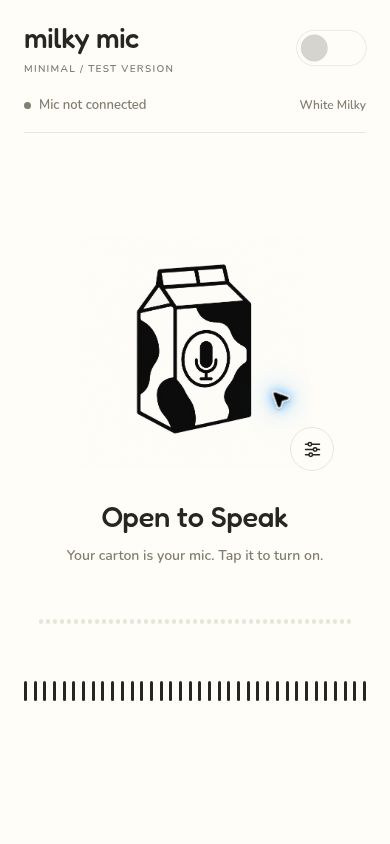
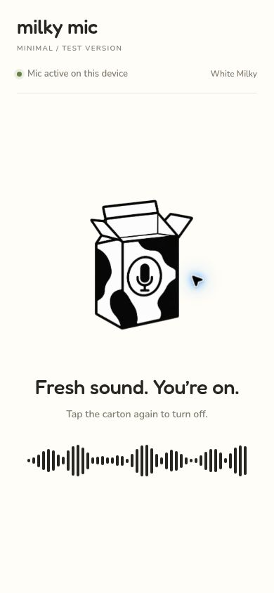
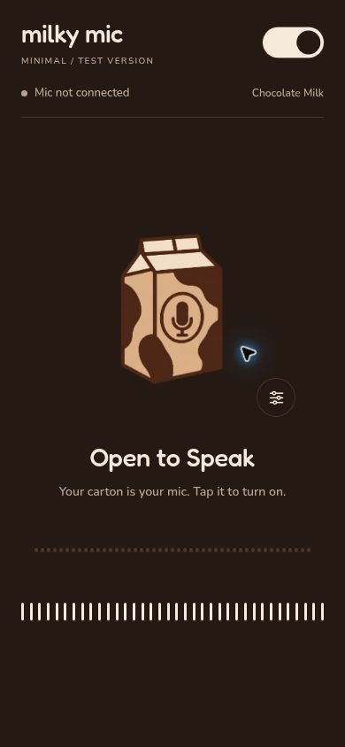

<div align="center">

# 🥛 Milky Mic

**Your phone. Your mic.**
Turn your Android phone into a PC microphone over Wi-Fi. Free, open source, no account, no cloud.

[](LICENSE)
[](https://github.com/TheSPX)

  

<sub>Design previews of the phone app, in both themes.</sub>

</div>

---

## What is it?

Milky Mic sends your phone's microphone to your PC, so Discord, FiveM, OBS or any other app can use it as a normal microphone. Your voice never leaves your home network.

Open source and built to be easy: one small PC page, one phone app, nothing to sign up for.

```
 phone mic ──► Milky Mic app ──Wi-Fi──► Milky Mic website (on your PC) ──► VB-Cable ──► Discord / game
                                                                              "CABLE Output" = your mic
```

- **A website, not an app, on the PC.** Run one command and a page opens in your browser, themed like the phone app.
- **Finds your PC for you.** The phone looks for the PC on your Wi-Fi. If it can't, type the PC's address, which the page shows you.
- **Pair once.** The page shows a 6-digit pairing code. Type it into the phone one time; both remember it. Strangers on your Wi-Fi can't connect without it.
- **Survives Wi-Fi hiccups.** If the link drops, the phone keeps listening and reconnects by itself for about a minute.
- **Two themes.** White Milky and Chocolate Milk, with the same toggle on the phone and the PC.
- **Low latency.** About 60 ms of buffer on the PC, and old audio is dropped instead of piling up.
- **Private by design.** The page only opens on the PC itself. Nothing is sent to the internet. No ads, no tracking, no telemetry.

## Quick start

You need: a Windows PC, an Android phone, and both on the same Wi-Fi.

### 1. Install the virtual cable (once)

Install the free [VB-Cable](https://vb-audio.com/Cable/) driver and reboot. It gives your PC a virtual microphone for other apps to listen to.

### 2. Start the PC page

You need [Node.js](https://nodejs.org) 18 or newer.

```bash
cd web
npm install
npm start
```

A page opens at `http://localhost:48770`. Use **Chrome or Edge**, because they can send sound to a chosen device. The page shows an address like `192.168.1.5` and a **pairing code** for your phone, and asks (once) to show your audio devices so it can find **CABLE Input**.

If Windows Firewall asks, allow Node.js on **private** networks. It needs TCP 48770 and UDP 48771.

### 3. Get the phone app

There is no ready-made APK yet, so you build it from source (about 15 minutes the first time). You need [Android Studio](https://developer.android.com/studio) (for the SDK and its bundled JDK 17+) and USB debugging on the phone.

```bash
cd android
npm install
npx expo run:android
```

On Windows, two things trip people up:

- **Gradle complains about Java 8.** Point it at Android Studio's JDK first:

  ```powershell
  $env:JAVA_HOME = "C:\Program Files\Android\Android Studio\jbr"
  $env:ANDROID_HOME = "$env:LOCALAPPDATA\Android\Sdk"
  ```

- **The native build stops with `ninja: error: mkdir ... No such file or directory`.** That is Windows' 260-character path limit. Keep the project in a short folder such as `C:\mm`, then build again.

### 4. Use it

1. Open Milky Mic on the PC (step 2), then on your phone.
2. Type the **pairing code** from the PC page into the phone (once). Your PC shows up in the list; tap it. No luck? Type the address from the PC page and tap Connect.
3. In Discord or your game, choose **CABLE Output** as the microphone.

Turn the phone screen off whenever you like. A notification is meant to keep streaming alive.

## Just want to see the design?

The phone app runs in **Expo Go** (Android or iPhone) in demo mode, with no network and no microphone:

```powershell
cd android
$env:EXPO_PUBLIC_MOCK = "1"
npx expo start --go
```

Scan the QR code. **Find PCs** shows a demo PC, and **Connect** opens the main screen.

## Project layout

| Folder | What it is |
|---|---|
| [`web/`](web) | The PC side: a tiny Node server (`server.js`) plus the website in `public/`. Includes a self-test: `npm test`. |
| [`android/`](android) | The phone app: Expo (React Native, TypeScript). `src/stream.ts` is the network and microphone code; `src/components/` holds the design's controls. |
| [`docs/`](docs) | Screenshots. |

How the pieces talk, if you want to hack on it:

- Discovery: the phone broadcasts UDP `POCKETMIC?` to port `48771`; the PC answers `POCKETMIC!<hostname>`.
- Audio: the phone opens a WebSocket to `ws://<pc>:48770/stream` and sends `POCKETMIC <pairing code> <phone model>` as text. The PC answers `ready` (or closes with 4003 wrong code, 4001 busy, 4004 too many tries). Then the phone sends raw **48 kHz, mono, 16-bit little-endian PCM** as binary frames.
- The website listens on `ws://localhost:48770/ui` and plays what arrives.
- The ports must match in `web/server.js` and `android/src/stream.ts`.

## Honest limitations

- **No encryption.** The pairing code decides who may connect, but audio still travels unencrypted inside your network. Use it on a network you trust. See [SECURITY.md](SECURITY.md).
- **Android only.** iPhone can run the demo (Expo Go) but not the real streaming.
- **One phone at a time**, and **Windows with VB-Cable** is the tested setup. macOS (BlackHole) and Linux should work with a virtual device, but are untested.
- **Needs Chrome or Edge on the PC**, because Firefox can't choose an audio output.

## Contributing

Issues and pull requests are welcome. Good places to start: a QR code for pairing, echo cancellation, a signed prebuilt APK, real voice filters, macOS and Linux notes. Keep it simple and friendly. More in [CONTRIBUTING.md](CONTRIBUTING.md); making a release APK is in [docs/RELEASING.md](docs/RELEASING.md).

```bash
cd web && npm test          # receiver end-to-end check
cd android && npx tsc --noEmit   # type-check the phone app
```

## Credits and license

Made by [**TheSPX**](https://github.com/TheSPX). Released under the [MIT License](LICENSE).

The toggle and slider controls are by Bencho (MIT). Fonts are Fredoka and Nunito (SIL OFL). VB-Cable is by VB-Audio and is not included. Details in [THIRD_PARTY_NOTICES.md](THIRD_PARTY_NOTICES.md).
